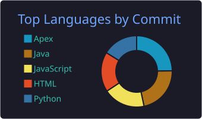
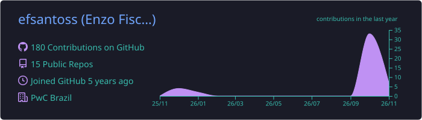

<h1 align="center">Hi, I'm Enzo Fischer 👋</h1>

<h3 align="center">Salesforce Developer · Administrator · Business Analyst</h3>

<i>Apex · Lightning Web Components · Agentforce · Integrations · Cloud & AI</i>

  
  
  

  
  

---

## 👨‍💻 About me

I'm a Salesforce professional with **3+ years on the platform** and **5+ years in software engineering**. I design, build and administer solutions end to end: custom development with **Apex** and **Lightning Web Components**, integrations across clouds and external systems, **Marketing Cloud** journeys and **Agentforce**.

Behind the platform there is a full stack foundation: **Java and Spring Boot**, **React and Angular**, **Python** and **AWS**. That is what lets me connect Salesforce to the rest of the stack and keep the solution clean, tested and maintainable.

I like turning business requirements into the simplest solution that actually moves the metric.

## 🔭 Right now

- 🤖 Building an **Agentforce SDR agent** as a Salesforce Developer, Administrator and Business Analyst.
- ✅ Recently delivered a **Salesforce Platform → Sales Cloud migration** for an enterprise client.
- 🎓 Doing an **MBA in Technology for Business** (AI, Data Science and Big Data) at PUCRS, 2026–2027.
- 🌱 Exploring applied AI and machine learning on top of the Salesforce platform.

---

## 🛠️ Tech stack

### ☁️ Salesforce

  

| Area | Tools |
| ---- | ----- |
| **Development** | Apex · Lightning Web Components · SOQL / SOSL · Apex Triggers · Jest |
| **Clouds** | Sales Cloud · Service Cloud · Marketing Cloud (Journeys, AMPscript, landing pages) |
| **Automation & AI** | Flow · OmniStudio (DataRaptors, Integration Procedures) · Agentforce |
| **Integrations** | REST APIs · cross-cloud and external system integrations |
| **DevOps** | Flosum · Salesforce CLI |

### 🎨 Front-end

  

### ⚙️ Back-end

  

### 🗄️ Databases

  

### 🚀 Cloud & CI/CD

  

### 🧠 Data & AI

  

**YOLO · Computer Vision · Agentforce · AWS Machine Learning**

### 📋 Agile & Project Management

  
  
  
  
  

---

## 📊 GitHub stats

  
  

  

Generated from my public repositories and refreshed daily by GitHub Actions.

---

## 🚀 Featured projects

| Project | What it is | Stack |
| ------- | ---------- | ----- |
| [**Upcoming Renewals**](https://github.com/efsantoss/Service-Agreement-Renewals) | Finds Service Agreements nearing expiration, creates a Renewal Task through a bulk-safe Apex trigger and gives the team an LWC to start renewal work. 45 Apex tests, 95% coverage. | Apex, LWC, Custom Metadata, Jest |
| **Salesforce End to End Automation** | Enterprise troubleshooting flow with dynamic Lightning Web Components, Apex controllers and external API integrations. | OmniStudio, DataRaptors, Apex, LWC |
| [**4 Vidas**](https://github.com/efsantoss/Capstone-Project-II) | Full stack platform connecting blood donors with collection centers, with availability tracking and operations for health institutions. | Java, Spring Boot, Angular, MongoDB |
| [**Cloud Image Processor**](https://github.com/efsantoss/AWS-Cloud) | Containerized Flask API for image upload, Canny edge detection and persistence, deployed on AWS. | Python, Flask, Docker, AWS |
| [**AI Parking Detection**](https://github.com/efsantoss/ProjetoIntegradorV) | Computer vision system for real-time vehicle detection and classification. | Python, YOLO, OpenCV |
| **EnergyMatch** | Backend that connects users with clean energy providers. | Java, Spring Boot, MongoDB, GraphQL |

More on my [portfolio](https://portfolio-enzo-fischer.vercel.app/).

---

## 🏅 Certifications

| | Certification |
| - | ------------- |
| ☁️ | Salesforce Certified Administrator |
| 🤖 | Salesforce Certified Agentforce Specialist |
| 🔁 | Flosum Certification |
| 🧠 | AWS Machine Learning Foundations |
| 📋 | Scrum Foundations + one more Scrum certification |

## 🎓 Education

- **MBA in Technology for Business** (AI, Data Science, Big Data), PUCRS *(in progress, 2026–2027)*
- **Bachelor in Information Systems**, PUC-Campinas
- **Associate Degree in Information and Communication Technology**, Pacific Link College, Canada

---

## 📬 Let's connect

- 🌐 Portfolio: [portfolio-enzo-fischer.vercel.app](https://portfolio-enzo-fischer.vercel.app/)
- 💼 LinkedIn: [linkedin.com/in/enzo-fischer-](https://www.linkedin.com/in/enzo-fischer-/)
- 📧 Email: enzo_fischer10@hotmail.com

⭐ If you like my work, feel free to follow me and star the repositories.

> Turning complex problems into scalable software with Salesforce, full stack engineering and cloud.
